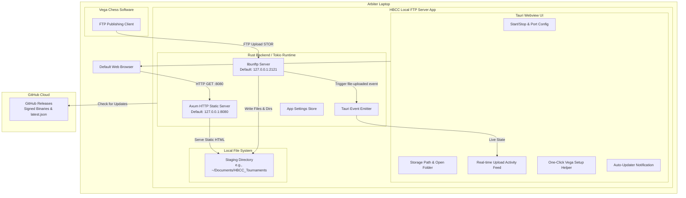

# Technical Design Specification: Local FTP & HTTP Server Desktop App for Vega Chess

- **Status:** Approved
- **Date:** 2026-10-17
- **Project Location:** `ftp-server/`
- **Target Platforms:** macOS & Windows (Cross-platform)

---

## 1. Problem Statement & Objectives

Hobsons Bay Chess Club arbiters run tournaments locally using the **Vega Chess** pairing and tournament management software. During or at the end of each round, Vega publishes tournament standings, pairings, cross-tables, and player cards by uploading generated HTML/data files via FTP.

Currently, arbiters either lack a simple local publishing target or have to configure external services.

### Core Objectives:
1. **Zero-friction Local FTP Server:** A desktop application that arbiters can launch with one click to listen on localhost (default port `2121`, configurable to `21` or any custom port) accepting uploads from Vega.
2. **Local Staging Storage:** Incoming files and folder structures from Vega are written directly to a designated local folder (`~/Documents/HBCC_Tournaments` by default, customizable).
3. **Embedded HTTP Preview Server:** Runs alongside FTP on port `8080`, allowing arbiters to click "Preview Local Site" to view tournament pages and pairings in their browser immediately.
4. **Auto-Update Mechanism:** Seamless updates via Tauri's official updater plugin pulling signed releases from GitHub Releases, eliminating manual re-downloads for arbiters.
5. **Future-Proof Extensibility:** Clean post-upload event hooks allowing future uplift to parse files and sync into the club's central database without altering the desktop app architecture.

---

## 2. System Architecture

---

## 3. Technology Stack & Components

| Component | Technology | Rationale |
|---|---|---|
| **App Framework** | Tauri v2 | Ultra-lightweight native binary (~15MB), minimal RAM usage (~30MB), built-in security and updater. |
| **Backend Language** | Rust (Tokio async) | High concurrency, zero runtime dependencies, robust memory safety and cross-platform native execution. |
| **FTP Server Engine** | `libunftp` / `unftp-sfs` | Asynchronous, RFC-compliant FTP server implementation with pluggable storage and auth backends. |
| **HTTP Preview Server**| `axum` + `tower-http` | Fast, lightweight static file server with automatic directory index listing for browsing tournament folders. |
| **Frontend Framework**| Vite + HTML/CSS/JS (Vanilla/React) | Fast load time, responsive controls, modern dark/light styling matching club brand colors. |
| **Auto-Updater** | `@tauri-apps/plugin-updater` | Built-in GitHub Releases integration with Ed25519 signature verification. |
| **File Dialogs & Opener** | `@tauri-apps/plugin-dialog` & `@tauri-apps/plugin-opener` | Native file picker for selecting folders and opening directory/browser with one click. |
| **Settings Storage** | `@tauri-apps/plugin-store` | Persists user preferences (port, custom path, autostart toggle) across sessions. |

---

## 4. Backend Specifications (Rust / Tauri)

### 4.1 FTP Server Configuration & Permissive Auth
* **Bind Address:** `127.0.0.1` by default (local loopback), with option in settings to bind to `0.0.0.0` (LAN).
* **Port Configuration:** Default is `2121`. Configurable to `21` (note: port 21 on Windows does not require admin; on macOS, privileged ports require elevated permissions, so 2121 is the default).
* **Authentication Provider:** Custom permissive authenticator implementing `libunftp::auth::Authenticator`.
  * Accepts any username and password supplied by Vega.
  * Allows anonymous logins without credentials.
* **Storage Backend:** `unftp-sfs` (Filesystem Storage) rooted dynamically at the user's configured staging directory.

### 4.2 Local HTTP Preview Server
* **Engine:** `axum` with `tower_http::services::ServeDir`.
* **Port:** Default `8080`.
* **Index Fallback:** If an uploaded folder does not contain a root `index.html`, the server generates a simple, responsive HTML tournament directory listing so arbiters can click into any active tournament subfolder.
* **Launch:** Starts automatically when the FTP server starts, stops when the FTP server stops.

### 4.3 Lifecycle & Concurrency
* **Tauri Commands:**
  * `start_servers(ftp_port: u16, http_port: u16, storage_path: String) -> Result<ServerStatus, String>`
  * `stop_servers() -> Result<(), String>`
  * `get_status() -> Result<ServerStatus, String>`
  * `open_storage_folder() -> Result<(), String>`
  * `open_preview_browser() -> Result<(), String>`
* **Graceful Shutdown:** Tokio `CancellationToken` enables instant, clean shutdowns without hanging ports or leaving zombie sockets.

### 4.4 Upload Notification & Extensibility Hook
* Whenever a file write completes (`STOR` command):
  * Emits Tauri event `ftp-file-received` with metadata (`filename`, `relativePath`, `sizeBytes`, `timestamp`).
  * Modular `OnFileReceived` trait/hook allows future database synchronization or running the Node.js parsing scripts.

---

## 5. Desktop UI & Arbiter Experience

### 5.1 Main Interface Layout
1. **Header Bar:**
   * HBCC Tournament FTP Server badge.
   * Status Pill: `🟢 Active (FTP: 2121 | HTTP: 8080)` or `🔴 Stopped`.
   * Action Buttons: "Start/Stop Server", "Preview Local Site" (opens browser).
2. **Configuration Panel:**
   * **Staging Directory:** Shows selected folder with "Change Folder" and "Open in Explorer/Finder" buttons.
   * **Port Settings:** Editable ports (FTP default: 2121, HTTP default: 8080) with reset-to-default button.
   * **Auto-Start Toggle:** "Start server automatically when application opens" (enabled by default).
3. **Vega Quick-Setup Card:**
   * Copyable connection instructions for Vega's FTP configuration dialog:
     * Server / Host: `127.0.0.1`
     * Port: `2121`
     * User: `vega` (or any text)
     * Password: `vega` (or any text)
     * Directory: `/`
4. **Live Activity Stream:**
   * Real-time list of uploaded files with search filter and "Clear Logs" button.
   * Shows file type icons (HTML, CSS, JSON, images), file size, and timestamp.
5. **Footer:**
   * Version information (e.g. `v0.1.0`).
   * "Check for Updates" button with download/install progress indicator.

---

## 6. Auto-Update & Distribution Strategy

### 6.1 Update Architecture
* Utilizes `@tauri-apps/plugin-updater`.
* Configured in `tauri.conf.json` with endpoint:
  `https://github.com/Hobsons-Bay-Chess-Club-AU/tournaments/releases/latest/download/latest.json`
* Public key embedded in `tauri.conf.json` for cryptographic validation.
* Background check on launch + manual "Check for Updates" button in UI.

### 6.2 CI/CD Release Pipeline (GitHub Actions)
* Triggered on version tag push (e.g. `ftp-v*`).
* Builds:
  * **Windows:** `.msi` and `.exe` (NSIS installer).
  * **macOS:** `.dmg` and `.app` (Universal binary for Apple Silicon & Intel).
* Signs artifacts with Tauri private key and publishes `latest.json` alongside binaries in GitHub Releases.

---

## 7. Error Handling & Edge Cases

| Scenario | Handling Strategy |
|---|---|
| **Port Collision (Port already occupied)** | Detects `AddrInUse` on startup; returns user-friendly error with one-click suggestion to change to alternative port (e.g., 2122 / 8081). |
| **Permissions on Port 21 (macOS)** | Default is set to non-privileged port `2121`. If arbiter enters `< 1024` on macOS/Linux, UI displays warning that root permissions are required. |
| **Target Directory Moved or Deleted** | Checks directory existence before starting; recreates directory if missing or prompts user to choose a valid directory. |
| **Partial / Interrupted FTP Upload** | Files are streamed directly to destination; file write completion event is only fired after `STOR` closure. |
| **Network Isolation** | Binds to `127.0.0.1` by default to prevent external/unauthorized network connections. |

---

## 8. Verification & Testing Plan

1. **Unit & Integration Tests (Rust):**
   * Server startup and shutdown on loopback interface.
   * Permissive authentication acceptance.
   * File upload via standard FTP client (`curl -T file.html ftp://127.0.0.1:2121 --user test:test`).
   * Static file serving via HTTP GET requests (`curl http://127.0.0.1:8080/file.html`).
2. **Desktop UI Verification:**
   * UI displays correct connection status and port numbers.
   * Changing directory updates storage location and persists after app restart.
   * "Open Folder" opens native Finder/Explorer.
   * "Preview Local Site" opens default browser to `http://127.0.0.1:8080`.
3. **End-to-End Test with Vega Publishing:**
   * Configure mock or real Vega Chess to publish to `127.0.0.1:2121`.
   * Verify all tournament HTML files appear in the destination folder.
   * Verify files are accessible in the browser preview.
